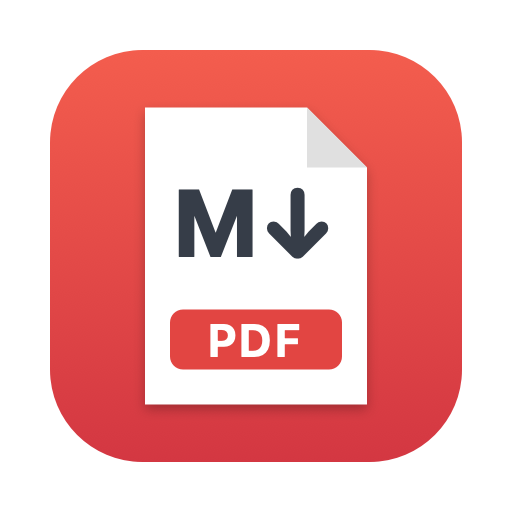
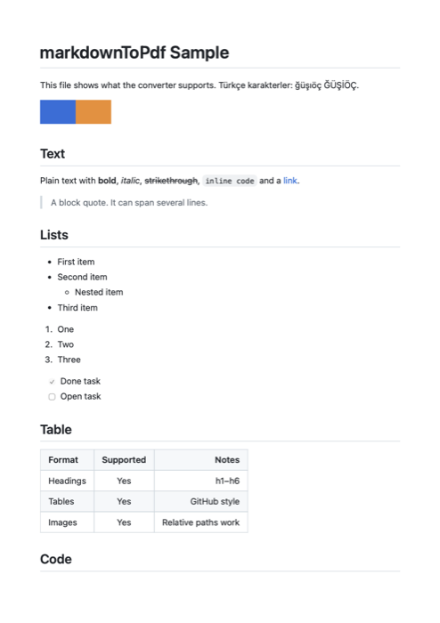

<p align="center">
  
</p>

<h1 align="center">markdownToPdf</h1>

<p align="center">
  A tiny native macOS app: drop Markdown files in, get clean PDFs out.
  <br>
  <a href="#installation">Install</a> ·
  <a href="#usage">Usage</a> ·
  <a href="#building-from-source">Build from source</a> ·
  <a href="#türkçe">Türkçe</a>
</p>

---

## Features

- **Drag & drop** one or many `.md` files onto the window.
- **One file at a time:** files are converted strictly in order.
- **Asks once per drop:** drop a single file and you pick its name and place; drop ten and you pick one folder, once, and all ten PDFs are saved there.
- **Loading screen** with the file name and "File 2 of 5" progress while converting.
- **GitHub-style output** on A4 pages: headings, tables, task lists, code blocks, block quotes, strikethrough and images.
- **Images with relative paths** (``) are picked up from next to the Markdown file.
- **Turkish and English** interface, chosen from your system language.
- Works offline. No accounts, no tracking, nothing leaves your Mac.
- Universal app: Apple silicon and Intel, macOS 13 Ventura or later.

<p align="center">
  
  <br>
  <sub>Page 1 of the PDF made from <a href="Examples/sample.md">Examples/sample.md</a></sub>
</p>

## Installation

### Option 1: one command

Open **Terminal** and paste:

```bash
curl -fsSL https://raw.githubusercontent.com/firatkill/markdownToPdf/main/install.sh | bash
```

This downloads the latest release, puts `markdownToPdf.app` in `/Applications` and opens it.

### Option 2: download by hand

1. Go to [Releases](https://github.com/firatkill/markdownToPdf/releases/latest) and download `markdownToPdf-x.y.z.zip`.
2. Double-click the zip and drag **markdownToPdf.app** into **Applications**.
3. The app is not notarized by Apple, so the first time macOS will refuse to open it. Either:
   - open **System Settings → Privacy & Security**, scroll down and click **Open Anyway**, or
   - run this once in Terminal:

     ```bash
     xattr -dr com.apple.quarantine /Applications/markdownToPdf.app
     ```

### Option 3: build it yourself

See [Building from source](#building-from-source).

## Usage

1. Open **markdownToPdf**.
2. Drag one or more Markdown files (`.md`, `.markdown`, `.txt`) onto the window, or click **Choose Files…** (⌘O).
3. While a file converts you see the loading screen.
4. **One file:** a save dialog opens with the same name as your file (`notes.md` → `notes.pdf`) in the same folder. Pick a place and click **Save**. **Cancel** skips the file.
5. **Several files at once:** after the first file is converted you are asked once for a folder. Every PDF from that drop is saved there with its own name (`notes.md` → `notes.pdf`). If a PDF with that name is already in the folder, nothing is overwritten: the new one is saved as `notes 2.pdf`. **Cancel** skips the whole drop.

You can drop more files while others are still being converted; they join the end of the list as a new drop, with their own folder question. Click **Saved** next to a finished file to show the PDF in Finder, or right-click it for **Open** and **Show in Finder**.

You can also right-click a Markdown file in Finder and choose **Open With → markdownToPdf**.

### Command line

The app binary can also convert without opening a window, which is handy in scripts:

```bash
/Applications/markdownToPdf.app/Contents/MacOS/markdownToPdf --convert notes.md notes.pdf
```

## Building from source

Requirements: macOS 13 or later and Swift 6.2 or later (Xcode 26, or the Command Line Tools: `xcode-select --install`).

```bash
git clone https://github.com/firatkill/markdownToPdf.git
cd markdownToPdf
scripts/build-app.sh
```

The app is written to `build/markdownToPdf.app` and a release zip to `dist/`. Copy the app into `/Applications`:

```bash
cp -R build/markdownToPdf.app /Applications/
```

Use `scripts/build-app.sh --native` to build only for your Mac's chip, which is about twice as fast.

For development, `swift run` starts the app straight from the package.

## How it works

| Step | What happens | Where |
|------|--------------|-------|
| Parse | Markdown is parsed with Apple's [swift-markdown](https://github.com/swiftlang/swift-markdown) (cmark-gfm, so GitHub Flavored Markdown) and turned into HTML. | [`MarkdownHTML.swift`](Sources/MarkdownToPdf/Rendering/MarkdownHTML.swift) |
| Style | The HTML gets a GitHub-like stylesheet tuned for paper. | same file |
| Print | A hidden `WKWebView` loads the page and WebKit's print engine writes a paginated A4 PDF. | [`PDFRenderer.swift`](Sources/MarkdownToPdf/Rendering/PDFRenderer.swift) |
| Queue | Files are processed strictly one by one: convert → ask where to save → save. | [`ConversionQueue.swift`](Sources/MarkdownToPdf/Queue/ConversionQueue.swift) |
| UI | One SwiftUI window with the drop zone, the file list and the loading overlay. | [`ContentView.swift`](Sources/MarkdownToPdf/Views/ContentView.swift) |

```
Sources/MarkdownToPdf/
├── App/          app entry point, Finder "Open With", command-line mode
├── Queue/        sequential conversion queue
├── Rendering/    Markdown → HTML → PDF
├── Support/      English/Turkish strings
└── Views/        the single window
Resources/        Info.plist template and app icon
scripts/          build-app.sh, make-icon.swift
```

## Releasing

Push a version tag and GitHub Actions builds the universal app and publishes the release:

```bash
git tag v1.0.0
git push origin v1.0.0
```

The version number in the app comes from the tag (`v1.2.3` → `1.2.3`); local builds use the [`VERSION`](VERSION) file.

## License

[MIT](LICENSE) © Fırat Kıl

---

## Türkçe

**markdownToPdf**, Markdown dosyalarını PDF'e çeviren küçük, yerel bir macOS uygulamasıdır.

### Özellikler

- Bir ya da birden çok `.md` dosyasını pencereye **sürükleyip bırakın**.
- Dosyalar **sırayla** işlenir.
- **Her bırakışta bir kez sorar:** tek dosya bırakırsanız adını ve yerini seçersiniz; on dosya bırakırsanız bir kez klasör seçersiniz ve on PDF'in hepsi oraya kaydedilir.
- Dönüştürme sırasında dosya adı ve "5 dosyadan 2. dosya" ilerlemesini gösteren bir **yükleme ekranı** çıkar.
- A4 sayfalarda GitHub tarzı çıktı: başlıklar, tablolar, görev listeleri, kod blokları, alıntılar ve görseller.
- Göreli yollu görseller (``) Markdown dosyasının yanından alınır.
- Arayüz sistem diline göre Türkçe ya da İngilizce açılır.
- İnternet gerektirmez; hiçbir veri bilgisayarınızdan çıkmaz.

### Kurulum

Terminal'i açıp şunu yapıştırın:

```bash
curl -fsSL https://raw.githubusercontent.com/firatkill/markdownToPdf/main/install.sh | bash
```

Ya da [Releases](https://github.com/firatkill/markdownToPdf/releases/latest) sayfasından zip dosyasını indirip `markdownToPdf.app`'i **Uygulamalar** klasörüne sürükleyin. Uygulama Apple tarafından onaylanmadığı (notarize edilmediği) için ilk açılışta macOS izin vermeyebilir. Bu durumda **Sistem Ayarları → Gizlilik ve Güvenlik** bölümünde **Yine de Aç**'a tıklayın ya da Terminal'de bir kez şunu çalıştırın:

```bash
xattr -dr com.apple.quarantine /Applications/markdownToPdf.app
```

### Kullanım

1. **markdownToPdf**'i açın.
2. Markdown dosyalarını pencereye bırakın ya da **Dosya Seç…** düğmesine tıklayın (⌘O).
3. Dönüştürme sırasında yükleme ekranı görünür.
4. **Tek dosya:** kaydetme penceresi, dosyanızın adıyla (`notlar.md` → `notlar.pdf`) aynı klasörde açılır. Yeri seçip **Kaydet**'e tıklayın. **Vazgeç** dosyayı atlar.
5. **Aynı anda birden çok dosya:** ilk dosya dönüştürülünce bir kez klasör sorulur. O bırakıştaki tüm PDF'ler kendi adlarıyla oraya kaydedilir. Klasörde aynı adlı bir PDF varsa üzerine yazılmaz, yenisi `notlar 2.pdf` olarak kaydedilir. **Vazgeç** o bırakışın tamamını atlar.

Biten bir dosyaya sağ tıklayınca **Aç** ve **Finder'da Göster** seçenekleri çıkar.

### Kaynaktan derleme

macOS 13+ ve Swift 6.2+ (Xcode 26 ya da Command Line Tools) gerekir:

```bash
git clone https://github.com/firatkill/markdownToPdf.git
cd markdownToPdf
scripts/build-app.sh
cp -R build/markdownToPdf.app /Applications/
```
